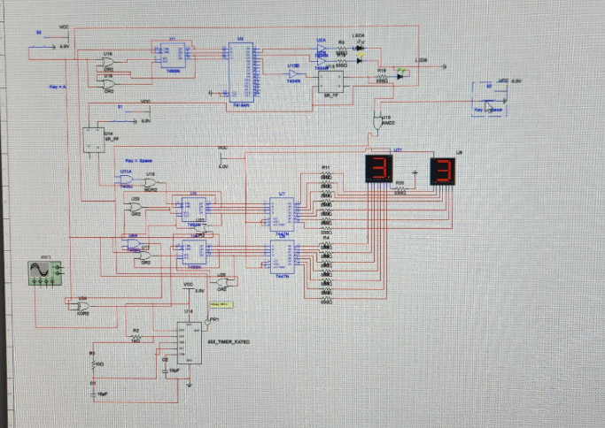
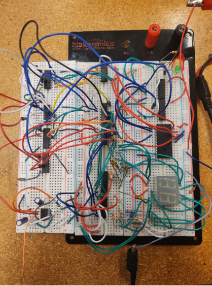
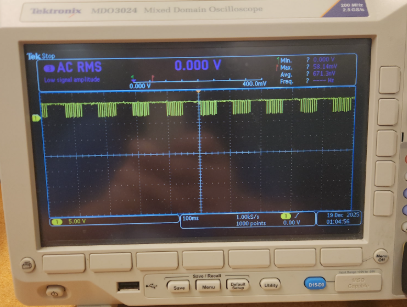

# Gravity Drag Strip Timing System

A digital timing system for toy-car gravity racing, designed in Multisim and built on breadboards as the final project for **ECET 111: Digital Circuits** at Purdue University Fort Wayne (December 2025).

**Team:** 4 students. I served as team lead.

> **Status:** Fully working in simulation. The breadboard prototype did not display timing values; see [Debugging Notes](#debugging-notes) for what we found and what I would check next.


*The full design in Multisim: starting tree (top), counting logic and 7447 display drivers (middle), and the 555 clock (bottom left).*

---

## What it does

- A **starting tree** sequences the yellow and green LEDs off a clock signal.
- When the green light turns on, the **timer starts**.
- Pressing the **finish button** stops the timer.
- Elapsed time shows on **two seven-segment displays** (seconds and tenths of seconds).
- A **master reset** returns every counter and the starting tree to the ready state.
- A **pause** function holds the displayed time.

## How it works

| Block | Parts | Role |
|---|---|---|
| Starting tree | 74164N shift register, 7404N inverters, red/yellow/green LEDs | Steps through the light sequence on each clock pulse |
| Clock | NE555 timer (astable) | Generates the timing pulses |
| Clock gating | AND gate (74xx08) | Lets clock pulses through only between green light and the finish button |
| Counting logic | 3 x 7483N 4-bit adders | Increments the time value in tenths and whole seconds |
| Display drivers | 2 x 7447 BCD-to-seven-segment decoders | Convert counter output to segment signals |
| Displays | 2 x common-anode seven-segment displays, current-limiting resistors | Show elapsed time |
| Controls | 2 momentary pushbuttons | Finish and master reset |

## Parts list

- 7483N x3
- 74164N x1
- 7404N x2
- AND gate IC (74xx08 or equivalent) x1
- 7447 x2
- NE555 timer IC x1
- Common-anode seven-segment displays x2
- Red, yellow, and green LEDs x1 each
- Momentary pushbuttons x2
- Resistors and capacitors (assorted values)
- Breadboards, jumper wires, laboratory DC power supply

## Design and build process

1. **Designed and simulated** the full circuit in Multisim, checking connectivity of each logic block.
2. **Tested the 555 clock on its own** before connecting it to the counting logic. When it first failed on the breadboard, I had the team rebuild it from scratch to rule out a faulty chip. The rebuilt circuit's output then matched the simulation on the oscilloscope.
3. **Built the starting tree** and confirmed that the shift register and inverters cycled the LEDs correctly in simulation.
4. **Added current-limiting resistors** between the 7447 outputs and the displays to protect the segments.
5. **Moved the design to breadboards**, grouping ICs to match the Multisim layout. Power and ground went to each IC first, then signal wires one at a time.
6. **Wired the master reset** to all counters and the starting tree.

## Results

**Simulation:** Worked as designed. The counter and displays ran correctly, and the reset and pause functions behaved as expected.

<!-- Add Multisim screenshots of the reset and pause functions here:


-->

**Hardware:** The breadboard prototype did not display timing values.


*The breadboard build: counters, decoders, 555 timer, and a seven-segment display.*


*Oscilloscope capture of the clock signal from the breadboard circuit.*

## Debugging notes

What we established:

- The **7447 decoders and the seven-segment displays work** when tested individually, so the fault is upstream of them.
- The **555 timer output on the breadboard matches the simulated waveform** on the oscilloscope, though not exactly. We suspected the small difference contributed to the problem.

What I would check next:

- **Counter structure.** The 7483 is a 4-bit adder, not a counter. Using it to count requires a register that stores the sum and feeds it back into the adder. I would verify that feedback path on the breadboard first.
- **Display driver control pins.** Floating or incorrectly tied LT, RBI, or BI pins on the 7447 can blank the display even when everything else works.
- **Power, ground, and signal continuity** on each IC, checked with a multimeter.
- **Probing each stage in order** (clock, gate, counter, decoder) to find where the signal stops.

## What I learned

- A design that works in simulation can fail on hardware, and timing and signal integrity matter much more on a real breadboard.
- Testing and troubleshooting one subsystem at a time is the fastest way to isolate a fault.
- Planning the layout and testing blocks before wiring everything saves a lot of time.
- Leading a team means splitting the design into blocks that can be built and tested independently.

## Tools

Multisim, breadboarding, oscilloscope, DC power supply, multimeter

## About me

I'm a Computer Engineering student at Purdue University Fort Wayne with coursework in **Python** and **MATLAB**, in addition to the digital circuit design in this project. More projects are coming to my profile.

## Files

```
https://docs.google.com/document/d/13bnem1IdaG7kdVfm0qDPtDYgecmVgGr9ybdBHdG1JNw/edit?usp=sharing
README.md                  This file
multisim-schematic.png     Multisim schematic
breadboard-prototype.png   Breadboard photo
555-oscilloscope.png       Oscilloscope capture
```

---

*ECET 111: Digital Circuits, Purdue University Fort Wayne, December 2025*
